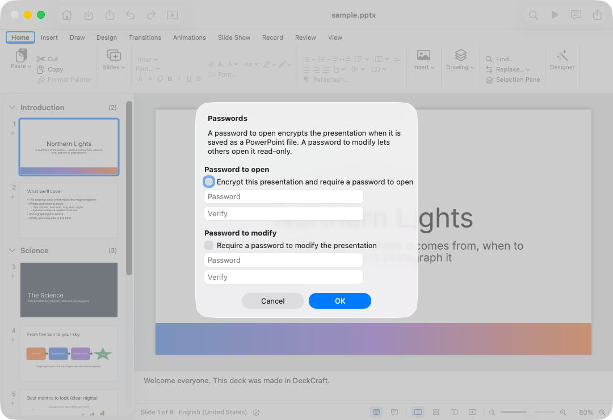
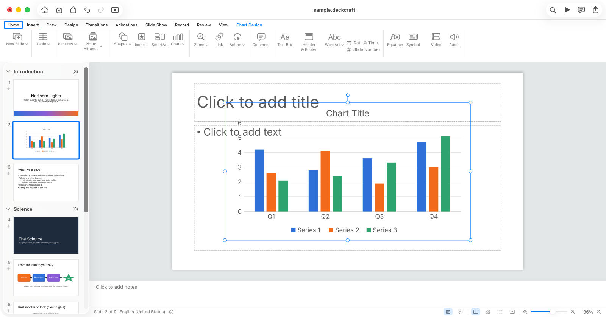
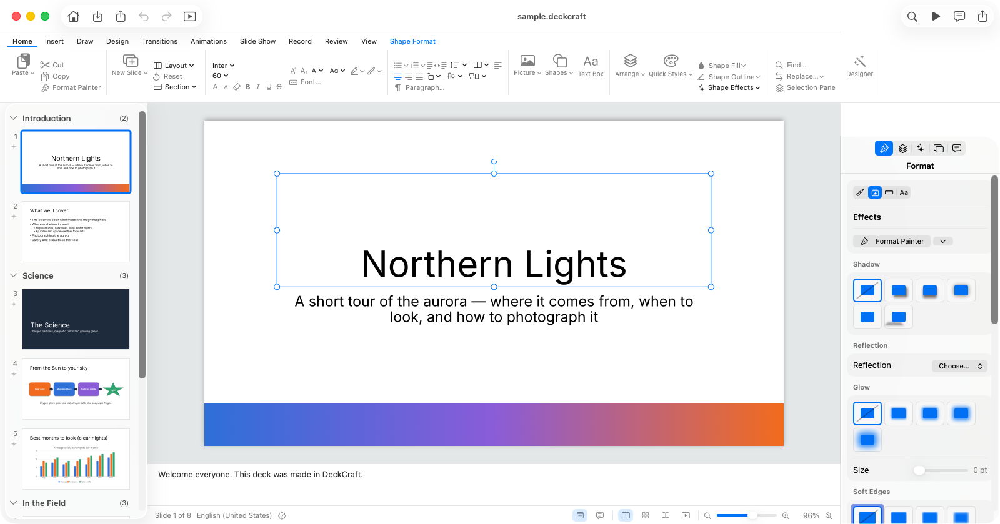
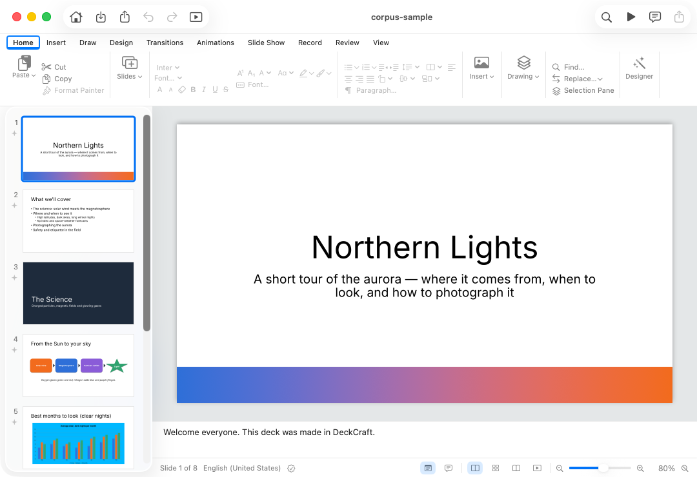
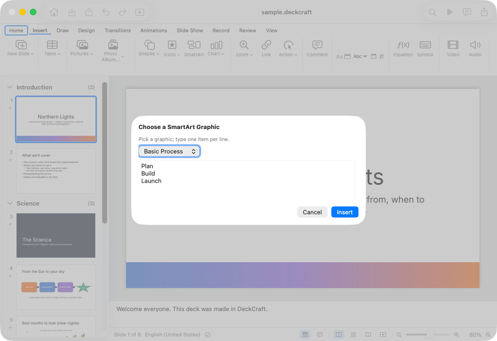
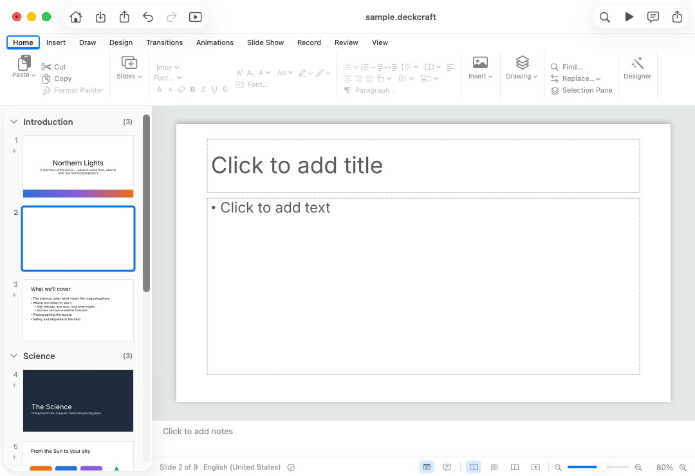
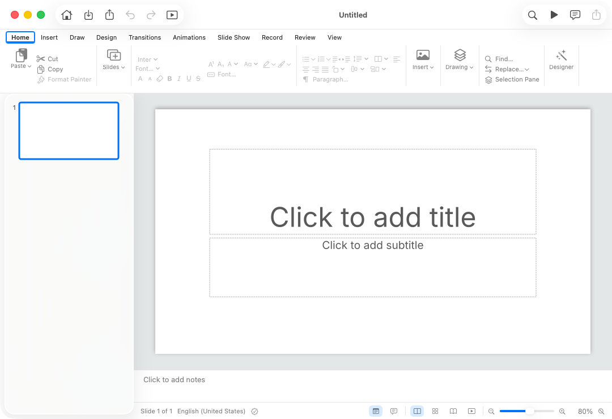

# Hand-test scenarios: HAND-TEST-2026-11: run of Nov 4, 2026 at 4:15 PM

- **App:** DeckCraftNative 0.1.15 (16), /Users/admin/Applications/DeckCraftNative.app
- **Scenario:** `/Users/admin/appprobe/scenario/HAND-TEST-2026-11.scenario.md`
- **Checklist:** `/Users/admin/appprobe/scenario/checklist.md`
- **Result:** 40 rows: 28 passed, 4 failed, 3 need you, 5 skipped; 10 checklist rows have no steps

## Needs you

### 10. File › Passwords… sets a password to open (typed twice) and one to modify

*Password protection* (checklist line 32)

> **File › Passwords…** sets a password to open (typed twice) and one to modify.

- 👀 shot 1: File › Passwords…
- 👀 Check the sheet asks for each password twice, then save as .pptx through Save As and reopen it.
- ✅ `windows.0.title == "sample.pptx"`
- ✅ `find("surface=app role=sheet").count == 1`



<details><summary>Steps (6216 ms)</summary>

```
launched DeckCraftNative pid 927, log /Users/admin/Library/Caches/AppProbe/logs/DeckCraftNative-2026-11-04T161128Z.log
opened /Users/admin/appprobe/scenario/fixtures/sample.pptx in pid 927
159: until windows.0.title == "sample.pptx" → ok (1073 ms)
160: menu "File › Passwords…" press → pressed File › Passwords… (173 ms)
161: until find("surface=app role=sheet").count == 1 → ok (604 ms)
162: shot "File › Passwords…" (193 ms)
```
</details>

### 21. What each insert draws on the slide is right: position, size, text, and the selection han…

*2. The ribbon's Insert tab* (checklist line 53)

> What each insert draws on the slide is right: position, size, text, and the selection handles around it.

- 👀 shot 1: a chart inserted on a new slide
- 👀 shot 2: judged: Is there a bar or column chart on the slide in the middle of the window, with selection handles around it?
- 👀 judge lfm3 (452 ms): Yes, there is a column chart on the slide in the middle of the window, and it has selection handles around it.
- 👀 The canvas is Metal: nothing on it is in the accessibility tree. ui.render / slide.inspect would check it (see the end).
- ✅ `find("role=statictext name='Slide 1 of 8' exact=true").count == 1`
- ✅ `find("role=statictext name='Slide 2 of 9' exact=true").count == 1`
- ✅ `find("role=radiobutton name='Chart Design, contextual' exact=true").count == 1`




<details><summary>Steps (10295 ms)</summary>

```
launched DeckCraftNative pid 1094, log /Users/admin/Library/Caches/AppProbe/logs/DeckCraftNative-2026-11-04T161245Z.log
opened /Users/admin/appprobe/scenario/fixtures/sample.deckcraft in pid 1094
332: until find("role=statictext name='Slide 1 of 8' exact=true").count == 1 → ok (1310 ms)
333: act role=radiobutton name=Insert exact=true action=press → {"action":"press","delivery":"delivered","element":{"frame":{"h":28,"w":98,"x":118,"y":327},"name":"Insert","ref":"W:sample.deckcraft/1/0/1@37b0","role":"radiob (196 ms)
334: act role=button name="New Slide" exact=true action=press → {"action":"press","delivery":"delivered","element":{"frame":{"h":20,"w":25,"x":34,"y":357},"help":"Add a slide after the current one.","name":"New Slide","ref": (105 ms)
335: until find("role=statictext name='Slide 2 of 9' exact=true").count == 1 → ok (66 ms)
336: act role=button name=Chart exact=true action=press → {"action":"press","delivery":"delivered","element":{"frame":{"h":19,"w":25,"x":458,"y":358},"help":"Add a chart drawn from data you can edit.","name":"Chart","r (64 ms)
337: until find("role=radiobutton name='Chart Design, contextual' exact=true").count == 1 → ok (343 ms)
338: resize width=1600 height=1000 → {"focused":true,"frame":{"h":839,"w":1600,"x":0,"y":270},"index":0,"key":"sample.deckcraft","main":true,"subrole":"AXStandardWindow","title":"sample.deckcraft"} (79 ms)
339: act role=button name="Fit slide to current window" exact=true action=press → {"action":"press","delivery":"delivered","element":{"frame":{"h":11,"w":11,"x":1576,"y":1090},"help":"Fit slide to current window","id":"arrow.up.left.and.down. (185 ms)
341: shot "a chart inserted on a new slide" (116 ms)
342: judge "Is there a bar or column chart on the slide in the middle of the window, with selection handles around it?" expect=yes → lfm3: yes (3426 ms)
```
</details>

### 28. Format › Effects (0

*4. The inspector* (checklist line 72)

> **Format › Effects** (0.1.10) shows Shadow, Glow and Soft Edges presets as drawn tiles, the one in use marked; choosing one applies it.

- 👀 shot 1: Format › Effects for the title
- 👀 Check each preset is drawn as a tile, the one in use is marked, and a click on another applies it.
- ✅ `find("role=statictext name='Slide 1 of 8' exact=true").count == 1`
- ✅ `find("role=radiobutton name=Arrange exact=true").count == 1`
- ✅ `find("role=heading name='Selection Pane' exact=true").count == 1`
- ✅ `find("role=checkbox name='Rotate Right 90°' exact=true").0.enabled == true`



<details><summary>Steps (8162 ms)</summary>

```
launched DeckCraftNative pid 1210, log /Users/admin/Library/Caches/AppProbe/logs/DeckCraftNative-2026-11-04T161345Z.log
opened /Users/admin/appprobe/scenario/fixtures/sample.deckcraft in pid 1210
461: until find("role=statictext name='Slide 1 of 8' exact=true").count == 1 → ok (1008 ms)
462: act role=radiobutton name=Home exact=true action=press → {"action":"press","delivery":"delivered","element":{"frame":{"h":28,"w":98,"x":12,"y":327},"name":"Home","ref":"W:sample.deckcraft/1/0/0@15ae","role":"radiobutt (68 ms)
463: act role=button name="Selection Pane" exact=true action=press → {"action":"press","delivery":"delivered","element":{"frame":{"h":15,"w":97,"x":855,"y":403},"help":"List every object on the slide to select, hide or reorder th (73 ms)
464: until find("role=radiobutton name=Arrange exact=true").count == 1 → ok (861 ms)
465: act role=radiobutton name=Arrange exact=true action=press → {"action":"press","delivery":"delivered","element":{"frame":{"h":24,"w":28,"x":910,"y":495},"help":"Arrange","id":"square.3.layers.3d","name":"Arrange","ref":"W (152 ms)
466: until find("role=heading name='Selection Pane' exact=true").count == 1 → ok (53 ms)
467: act role=button name="Title 1" exact=true action=press → {"action":"press","delivery":"delivered","element":{"frame":{"h":14,"w":155,"x":862,"y":1029},"name":"Title 1","ref":"W:sample.deckcraft/0/5/2/7/6/0@1e95","role (181 ms)
468: until find("role=checkbox name='Rotate Right 90°' exact=true").0.enabled == true → ok (158 ms)
469: act role=radiobutton name=Format exact=true action=press → {"action":"press","delivery":"delivered","element":{"frame":{"h":24,"w":29,"x":880,"y":495},"help":"Format","id":"paintbrush","name":"Format","ref":"W:sample.de (311 ms)
470: resize width=1600 height=1000 → {"focused":true,"frame":{"h":839,"w":1600,"x":0,"y":270},"index":0,"key":"sample.deckcraft","main":true,"subrole":"AXStandardWindow","title":"sample.deckcraft"} (73 ms)
471: act role=button name="Fit slide to current window" exact=true action=press → {"action":"press","delivery":"delivered","element":{"frame":{"h":11,"w":11,"x":1321,"y":1090},"help":"Fit slide to current window","id":"arrow.up.left.and.down. (66 ms)
472: act role=radiobutton name=Effects exact=true action=press → {"action":"press","delivery":"delivered","element":{"frame":{"h":20,"w":22,"x":1389,"y":568},"help":"Effects","id":"sparkles.rectangle.stack","name":"Effects"," (370 ms)
474: shot "Format › Effects for the title" (48 ms)
```
</details>

## Failed

### 11. Open `corpus-sample

*PowerPoint 97–2003 `.ppt`* (checklist line 36)

> Open `corpus-sample.ppt`. It opens as an untitled converted copy ("corpus-sample", 8 slides), and the **status line says what was converted** (picture bullets, one embedded object as a picture). The original isn't changed; Save asks for a name.

**Failed:** the status line says what was converted: not so (`find("surface=app role=statictext text='was converted and opened as a copy'").count > 0` read 0)

- 👀 shot 1: end
- ✅ `windows.0.title == "corpus-sample"`
- ✅ `find("role=statictext name='Slide 1 of 8' exact=true").count == 1`
- ❌ `find("surface=app role=statictext text='was converted and opened as a copy'").count > 0`, got `0`



<details><summary>Steps (6549 ms)</summary>

```
launched DeckCraftNative pid 939, log /Users/admin/Library/Caches/AppProbe/logs/DeckCraftNative-2026-11-04T161135Z.log
opened /Users/admin/appprobe/scenario/fixtures/corpus-sample.ppt in pid 939
171: until windows.0.title == "corpus-sample" timeout=30000 → ok (1319 ms)
172: until find("role=statictext name='Slide 1 of 8' exact=true").count == 1 → ok (147 ms)
175: expect find("surface=app role=statictext text='was converted and opened as a copy'").count > 0 → got 0 (165 ms)
```
</details>

### 32. The SmartArt dialog's graphic pop-up has a name VoiceOver reads, not its form key

*4. The inspector*

> The SmartArt dialog's graphic pop-up has a name VoiceOver reads, not its form key.

**Failed:** not "kind": not so (`find("role=popupbutton name=kind exact=true").count == 0` read 1)

- 👀 open sheet: Choose a SmartArt Graphic · Pick a graphic; type one item per line.
- 👀 shot 1: end
- ✅ `find("role=statictext name='Slide 1 of 8' exact=true").count == 1`
- ✅ `find("role=statictext name='Choose a SmartArt Graphic' exact=true").count == 1`
- ✅ `find("role=popupbutton value='Basic Process'").count == 1`
- ❌ `find("role=popupbutton name=kind exact=true").count == 0`, got `1`



<details><summary>Steps (6885 ms)</summary>

```
launched DeckCraftNative pid 1389, log /Users/admin/Library/Caches/AppProbe/logs/DeckCraftNative-2026-11-04T161420Z.log
opened /Users/admin/appprobe/scenario/fixtures/sample.deckcraft in pid 1389
535: until find("role=statictext name='Slide 1 of 8' exact=true").count == 1 → ok (1641 ms)
536: act role=radiobutton name=Insert exact=true action=press → {"action":"press","delivery":"delivered","element":{"frame":{"h":28,"w":98,"x":118,"y":327},"name":"Insert","ref":"W:sample.deckcraft/1/0/1@37b0","role":"radiob (265 ms)
537: act role=button name=SmartArt exact=true action=press → {"action":"press","delivery":"delivered","element":{"frame":{"h":37,"w":44,"x":400,"y":358},"help":"Add a diagram that lays out a list, a process or a hierarchy (412 ms)
538: until find("role=statictext name='Choose a SmartArt Graphic' exact=true").count == 1 → ok (100 ms)
539: expect find("role=popupbutton value='Basic Process'").count == 1 → ok (45 ms)
540: expect find("role=popupbutton name=kind exact=true").count == 0 → got 1 (55 ms)
```
</details>

### 33. Edit › Undo and Redo name the action, as macOS apps and PowerPoint do: "Undo New Slide", …

*5. Undo* (checklist line 81)

> **Edit › Undo and Redo name the action**, as macOS apps and PowerPoint do: "Undo New Slide", "Redo New Slide" (PLAN.md §3: `NSUndoManager` shows the menu titles).

**Failed:** Undo names the action: not so (`menu("Edit › Undo*").name == "Undo New Slide"` read "Undo")

- 👀 After Insert › New Slide, Edit's first item reads: Undo
- 👀 shot 1: end
- ✅ `find("role=statictext name='Slide 1 of 8' exact=true").count == 1`
- ✅ `menu("Edit › Undo*").enabled == false`
- ✅ `find("role=statictext name='Slide 2 of 9' exact=true").count == 1`
- ❌ `menu("Edit › Undo*").name == "Undo New Slide"`, got `"Undo"`



<details><summary>Steps (7298 ms)</summary>

```
launched DeckCraftNative pid 1402, log /Users/admin/Library/Caches/AppProbe/logs/DeckCraftNative-2026-11-04T161427Z.log
opened /Users/admin/appprobe/scenario/fixtures/sample.deckcraft in pid 1402
551: until find("role=statictext name='Slide 1 of 8' exact=true").count == 1 → ok (1705 ms)
552: expect menu("Edit › Undo*").enabled == false → ok (223 ms)
553: menu "Insert › New Slide" press → pressed Insert › New Slide (175 ms)
554: until find("role=statictext name='Slide 2 of 9' exact=true").count == 1 → ok (172 ms)
555: set undoName = menu("Edit › Undo*").name → "Undo" (158 ms)
557: expect menu("Edit › Undo*").name == "Undo New Slide" → got "Undo" (145 ms)
```
</details>

### 39. A new presentation is named as PowerPoint names it, "Presentation1", whichever way it's m…

*7. Everyday flows*

> A new presentation is named as PowerPoint names it, "Presentation1", whichever way it's made.

**Failed:** PowerPoint's name, as the Start tile gives: not so (`windows.0.title == "Presentation1"` read "Untitled")

- 👀 File › New Presentation made a window titled Untitled.
- 👀 shot 1: end
- ✅ `windows.0.title == "Start"`
- ✅ `windows.0.title != "Start"`
- ❌ `windows.0.title == "Presentation1"`, got `"Untitled"`



<details><summary>Steps (5938 ms)</summary>

```
launched DeckCraftNative pid 1448, log /Users/admin/Library/Caches/AppProbe/logs/DeckCraftNative-2026-11-04T161455Z.log
630: until windows.0.title == "Start" → ok (0 ms)
631: menu "File › New Presentation" press → pressed File › New Presentation (181 ms)
632: until windows.0.title != "Start" → ok (1317 ms)
633: set title = windows.0.title → "Untitled" (0 ms)
635: expect windows.0.title == "Presentation1" → got "Untitled" (0 ms)
```
</details>

## Passed

- **1. Open `sample** (checklist line 21): windows.0.title == "sample.deckcraft"; find("role=statictext name='Slide 1 of 8' exact=true").count == 1; find("role=cell name='Slide 8' exact=true").count == 1; find("role=cell name=Introduction exact=true").count == 1; find("role=cell name=Science exact=true").count == 1; find("role=cell name='In the Field' exact=true").count == 1; find("role=textarea name=Notes").0.value contains "Welcome everyone" (3394 ms)
- **2. Add a slide to `save-roundtrip** (checklist line 22): find("role=statictext name='Slide 1 of 8' exact=true").count == 1; find("role=statictext name='Slide 2 of 9' exact=true").count == 1; find("surface=app role=sheet").count == 0; windows.*.title !contains ["save-roundtrip.deckcraft"]; windows.0.title == "save-roundtrip.deckcraft"; find("role=statictext name='Slide 1 of 9' exact=true").count == 1; find("role=statictext text='of 8'").count == 1 (8973 ms)
- **3. Open `save-roundtrip** (checklist line 23): windows.0.title == "save-roundtrip.pptx"; find("role=statictext name='Slide 1 of 8' exact=true").count == 1; find("role=statictext name='Slide 2 of 9' exact=true").count == 1; find("surface=app role=sheet").count == 0; windows.*.title !contains ["save-roundtrip.pptx"]; windows.0.title == "save-roundtrip.pptx"; find("role=statictext name='Slide 1 of 9' exact=true").count == 1; find("role=statictext text='of 8'").count == 1 (11129 ms)
- **6. Two presentations side by side (0** (checklist line 26): windows.*.title contains ["sample.deckcraft"]; windows.*.title contains ["sample.pptx"]; windows.count == 3; windows.count == 3; windows.*.title contains ["sample.deckcraft"]; windows.*.title contains ["sample.pptx"] (8142 ms)
- **7. Open `protected-ascii** (checklist line 29): find("surface=app role=textfield name=Password exact=true").count == 1; find("surface=app role=statictext text=protected-ascii.pptx").count == 1; find("surface=app role=statictext text='The password is incorrect. Passwords are case-sensitive.'").count == 1; windows.*.title contains ["protected-ascii.pptx"]; find("role=statictext name='Slide 1 of 5' exact=true").count == 1 (6723 ms)
- **8. Open `protected-accents** (checklist line 30): find("surface=app role=textfield name=Password exact=true").count == 1; windows.*.title contains ["protected-accents.pptx"]; find("surface=app role=statictext text='password is incorrect'").count == 0 (6443 ms)
- **9. Cancel at the password prompt** (checklist line 31): find("surface=app role=textfield name=Password exact=true").count == 1; windows.*.title !contains ["protected-ascii.pptx"]; find("surface=app role=textfield name=Password exact=true").count == 0; find("surface=app role=dialog").count == 0 (6479 ms)
- **12. Open `protected-default** (checklist line 37): windows.0.title == "protected-default"; find("surface=app role=textfield name=Password exact=true").count == 0; find("role=statictext name='Slide 1 of 8' exact=true").count == 1 (5302 ms)
- **13. Open `damaged** (checklist line 38): find("surface=app role=dialog").count == 1; windows.count >= 1; windows.*.title !contains ["damaged"] (5922 ms)
- **14. Insert › New Slide (the ribbon button, the menu, ⇧⌘N)** (checklist line 44): find("role=statictext name='Slide 1 of 8' exact=true").count == 1; find("role=statictext name='Slide 2 of 9' exact=true").count == 1; find("role=statictext name='Slide 3 of 10' exact=true").count == 1; find("role=statictext name='Slide 4 of 11' exact=true").count == 1; find("role=statictext text='of 10'").count == 1; find("role=statictext text='of 11'").count == 1 (7161 ms)
- **15. Insert › Table… (menu) asks for columns and rows (0** (checklist line 45) ◐: partly checked, not: the ribbon's Table arrow and its grid; the table's 3 × 4 shape on the slide; find("role=statictext name='Slide 1 of 8' exact=true").count == 1; find("role=textfield name='Number of columns:' exact=true").count == 1; find("role=radiobutton name='Table Design, contextual' exact=true").count == 1; find("role=radiobutton name='Layout, contextual' exact=true").count == 1; find("role=radiobutton name='Table Design, contextual' exact=true").count == 0; find("role=radiobutton name='Table Design, contextual' exact=true").count == 1; find("surface=app role=sheet").count == 0 (7880 ms)
- **16. Chart adds a chart, and the Chart Design tab appears** (checklist line 46): find("role=statictext name='Slide 1 of 8' exact=true").count == 1; find("role=radiobutton name='Chart Design, contextual' exact=true").count == 1 (5394 ms)
- **17. Format › Chart › Chart Elements in the inspector (0** (checklist line 47) ◐: partly checked, not: that each change shows on the chart (the canvas); find("role=statictext name='Slide 1 of 8' exact=true").count == 1; find("role=radiobutton name='Chart Design, contextual' exact=true").count == 1; find("role=radiobutton name=Arrange exact=true").count == 1; find("role=heading name='Chart Elements' exact=true").count == 1; find("role=switch").*.value == ["1", "0", "1"]; find("role=switch").1.value == "1"; find("role=popupbutton value=Right").count == 1; find("role=popupbutton value=Bottom").count == 1; find("role=switch").1.value == "1"; find("role=switch").1.value == "0" (8482 ms)
- **18. Chart Design › Add Chart Element (0** (checklist line 48): find("role=statictext name='Slide 1 of 8' exact=true").count == 1; find("role=radiobutton name='Chart Design, contextual' exact=true").count == 1; find("role=button name='Add Chart Element' exact=true").count == 1; find("surface=app role=menuitem name='Chart Title' exact=true").count == 1; find("surface=app role=menuitem name=Legend exact=true").0.ref matches "^A/0/"; find("surface=app role=menuitem name='Data Labels' exact=true").0.ref matches "^A/0/"; find("surface=app role=menuitem name=Gridlines exact=true").0.ref matches "^A/0/"; find("surface=app role=menuitem name='Above Chart' exact=true").0.ref matches "^A/0/"; find("surface=app role=menuitem name=Top exact=true").0.ref matches "^A/0/"; find("surface=app role=menuitem name=Bottom exact=true").0.ref matches "^A/0/"; find("surface=app role=menuitem name=Show exact=true").0.ref matches "^A/0/"; find("surface=app role=menuitem name='Major Gridlines' exact=true").0.ref matches "^A/0/"; find("role=radiobutton name=Arrange exact=true").count == 1; find("role=popupbutton value=Left").count == 1 (9256 ms)
- **19. SmartArt asks for a graphic and its items ("Choose a SmartArt Graphic")** (checklist line 49): find("role=statictext name='Slide 1 of 8' exact=true").count == 1; find("role=statictext name='Choose a SmartArt Graphic' exact=true").count == 1; find("role=textfield text='SmartArt items'").0.value contains "Plan"; find("role=radiobutton name='SmartArt Design, contextual' exact=true").count == 1 (6350 ms)
- **20. Text Box and Comment (the comment sheet's Post shows it in the Comments pane)** (checklist line 50): find("role=statictext name='Slide 1 of 8' exact=true").count == 1; find("role=radiobutton name='Shape Format, contextual' exact=true").count == 1; find("role=statictext name='New Comment' exact=true").count == 1; find("text='Check this number'").count > 0 (7824 ms)
- **22. Slide Show (the status bar's button, ⌘Enter): it fills the screen** (checklist line 59) ◐: partly checked, not: what the show draws (Metal) and its transitions; find("role=statictext name='Slide 1 of 8' exact=true").count == 1; windows.count == 2; windows.count == 1; find("role=statictext name='Slide 2 of 8' exact=true").count == 1 (12216 ms)
- **23. Slide Show › Set Up Slide Show… opens its dialog (0** (checklist line 62): find("role=statictext name='Slide 1 of 8' exact=true").count == 1; find("surface=app role=sheet").count == 1; find("surface=app role=checkbox text='Keep mouse cursor visible'").count == 1 (6854 ms)
- **24. Reading View (status bar): a window reading "Slide N of M"** (checklist line 63): find("role=statictext name='Slide 1 of 8' exact=true").count == 1; windows.0.title == "Reading View"; find("window='Reading View' role=statictext name='Slide 1 of 8' exact=true").count == 1; find("window='Reading View' role=statictext name='Slide 2 of 8' exact=true").count == 1; find("window='Reading View' role=statictext name='Slide 2 of 8' exact=true").count == 1; find("window='Reading View' role=statictext name='Slide 3 of 8' exact=true").count == 1; find("window='Reading View' role=statictext name='Slide 2 of 8' exact=true").count == 1; windows.*.title !contains ["Reading View"]; find("role=statictext name='Slide 2 of 8' exact=true").count == 1 (9232 ms)
- **25. Arrange › Selection Pane lists the slide's shapes; choosing one selects it, and its conte…** (checklist line 69): find("role=statictext name='Slide 1 of 8' exact=true").count == 1; find("role=radiobutton name=Arrange exact=true").count == 1; find("role=heading name='Selection Pane' exact=true").count == 1; $shapes == 3; find("role=checkbox name='Rotate Right 90°' exact=true").0.enabled == false; find("role=checkbox name='Rotate Right 90°' exact=true").0.enabled == true; find("role=radiobutton name='Shape Format, contextual' exact=true").count == 1 (6724 ms)
- **26. Arrange › Rotate Right 90° turns it: Format › Size reads Rotation 90°, and Undo brings it…** (checklist line 70): find("role=statictext name='Slide 1 of 8' exact=true").count == 1; find("role=radiobutton name=Arrange exact=true").count == 1; find("role=heading name='Selection Pane' exact=true").count == 1; find("role=checkbox name='Rotate Right 90°' exact=true").0.enabled == true; find("role=textfield name='Rotation, Rotation value' exact=true").0.value == "90°"; find("role=textfield name='Rotation, Rotation value' exact=true").0.value == "0°" (7392 ms)
- **27. Format › Size: typing a Width changes it, and Scale Width follows** (checklist line 71): find("role=statictext name='Slide 1 of 8' exact=true").count == 1; find("role=radiobutton name=Arrange exact=true").count == 1; find("role=heading name='Selection Pane' exact=true").count == 1; find("role=checkbox name='Rotate Right 90°' exact=true").0.enabled == true; find("role=textfield name='Width, Width value' exact=true").count == 1; find("role=textfield name='Width, Width value' exact=true").0.value matches "^5"; find("role=textfield name='Scale Width, Scale Width value' exact=true").0.value != "100%" (7480 ms)
- **29. Format › Fill (0** (checklist line 73): find("role=statictext name='Slide 1 of 8' exact=true").count == 1; find("role=radiobutton name=Arrange exact=true").count == 1; find("role=heading name='Selection Pane' exact=true").count == 1; find("role=checkbox name='Rotate Right 90°' exact=true").0.enabled == true; find("role=radiobutton name='Slide background fill' exact=true").count == 1; find("role=radiobutton name='Slide background fill' exact=true").0.value == "1" (7139 ms)
- **30. Format Painter (0** (checklist line 74): find("role=statictext name='Slide 1 of 8' exact=true").count == 1; find("role=radiobutton name=Arrange exact=true").count == 1; find("role=heading name='Selection Pane' exact=true").count == 1; find("role=button name='Format Painter' exact=true").count == 1; find("role=menubutton name='Format Painter options' exact=true").count == 1 (8159 ms)
- **31. Every inspector control has a name VoiceOver reads, Chart Elements included (0** (checklist line 75) ◐: partly checked, not: Chart Elements only, and through their labels: AppProbe reads a name from AXTitle or AXDescription, and these controls are labelled through AXTitleUIElement, which VoiceOver reads (checked 2026-11-04 with a one-off AX read: Chart Title, Title, Legend, Data Labels, Gridlines); find("role=statictext name='Slide 1 of 8' exact=true").count == 1; find("role=radiobutton name='Chart Design, contextual' exact=true").count == 1; find("role=radiobutton name=Arrange exact=true").count == 1; find("role=heading name='Chart Elements' exact=true").count == 1; find("role=switch").count == 3; find("role=statictext name='Chart Title' exact=true").count == 1; find("role=statictext name='Data Labels' exact=true").count == 1; find("role=statictext name=Gridlines exact=true").count == 1; find("role=statictext name=Legend exact=true").count == 1; find("role=statictext name=Title exact=true").count == 1 (11982 ms)
- **34. Undo and Redo through a longer session (a slide, a table, a rotation): each step comes ba…** (checklist line 82): find("role=statictext name='Slide 1 of 8' exact=true").count == 1; find("role=radiobutton name=Arrange exact=true").count == 1; find("role=heading name='Selection Pane' exact=true").count == 1; find("role=checkbox name='Rotate Right 90°' exact=true").0.enabled == true; find("role=statictext name='Slide 2 of 9' exact=true").count == 1; find("role=radiobutton name='Table Design, contextual' exact=true").count == 1; find("role=radiobutton name='Table Design, contextual' exact=true").count == 0; find("role=statictext text='of 8'").count == 1; menu("Edit › Undo*").enabled == false; find("role=statictext text='of 9'").count == 1; menu("Edit › Redo*").enabled == false (14117 ms)
- **38. A launch with nothing to open shows the Start window: Home, New and Open, the theme tiles…** (checklist line 99) ◐: partly checked, not: a tile's press (made through File › New Presentation instead), the tiles' pictures, and the recent list (it shows this Mac's files, so the run neither reads nor screenshots it); windows.0.title == "Start"; find("window=Start role=button name='Blank Presentation' exact=true").count == 1; find("window=Start role=button name=Harbor exact=true").count == 1; find("window=Start role=button name='Sample deck: Northern Lights' exact=true").count == 1; find("window=Start role=button name=Briefing exact=true").count == 1; find("window=Start role=button name='Evening Talk' exact=true").count == 1; windows.0.title != "Start"; find("role=statictext name='Slide 1 of 1' exact=true").count == 1 (6272 ms)
- **40. Slide Sorter and Normal views from the status bar; sections fold and unfold** (checklist line 100): find("role=statictext name='Slide 1 of 8' exact=true").count == 1; find("role=cell name='Slide 3' exact=true").count == 0; find("role=cell name='Slide 3' exact=true").count == 1; find("role=textarea name=Notes").count == 1 (8344 ms)
## Skipped

- **4. File › Save As… to the other format, `** (checklist line 24): Save As goes through the system save panel, which AppProbe can't point at a folder (keys don't reach it) (0 ms)
- **5. Save a deck with a chart as `** (checklist line 25): needs PowerPoint, the black-box oracle (Tools/pptx/powerpoint-sweep.sh), on the operator's Mac (0 ms)
- **35. Click a shape to select it; drag it (smart guides appear); resize it by a handle; rotate …** (checklist line 90): the canvas is a Metal view with no accessibility elements; it needs the control-channel step (below) (0 ms)
- **36. Double-click a text box and type, including an accented letter and dictation; the text wr…** (checklist line 91): in-place text editing is on the canvas; it needs the control-channel step (below) (0 ms)
- **37. Draw a shape from the Shapes gallery by dragging on the slide** (checklist line 92): drawing is a drag on the canvas; it needs the control-channel step (below) (0 ms)
## Results rows

In the checklist's format, to copy in (`fill=true` writes the failures in, and ticks the passes).

| # | Step | What happened | Undo name | Task filed |
|---|------|---------------|-----------|------------|
| 10 | File › Passwords… sets a password to open (typed twice) and one to modify | for you to judge: shot 1: File › Passwords…; Check the sheet asks for each password twice, then save as .pptx through Save As and reopen it.; windows.0.title == "sample.pptx"; find("surface=app role=sheet").count == 1 | (none) | |
| 11 | Open `corpus-sample | the status line says what was converted: not so (`find("surface=app role=statictext text='was converted and opened as a copy'").count > 0` read 0) | (none) | |
| 21 | What each insert draws on the slide is right: position, size, text, and the selection han… | for you to judge: shot 1: a chart inserted on a new slide; shot 2: judged: Is there a bar or column chart on the slide in the middle of the window, with selection handles around it?; judge lfm3 (452 ms): Yes, there is a column chart on the slide in the middle of the window, and it has selection handles around it.; The canvas is Metal: nothing on it is in the accessibility tree. ui.render / slide.inspect would check it (see the end).; find("role=statictext name='Slide 1 of 8' exact=true").count == 1; find("role=statictext name='Slide 2 of 9' exact=true").count == 1; find("role=radiobutton name='Chart Design, contextual' exact=true").count == 1 | (none) | |
| 28 | Format › Effects (0 | for you to judge: shot 1: Format › Effects for the title; Check each preset is drawn as a tile, the one in use is marked, and a click on another applies it.; find("role=statictext name='Slide 1 of 8' exact=true").count == 1; find("role=radiobutton name=Arrange exact=true").count == 1; find("role=heading name='Selection Pane' exact=true").count == 1; find("role=checkbox name='Rotate Right 90°' exact=true").0.enabled == true | (none) | |
| 32 | The SmartArt dialog's graphic pop-up has a name VoiceOver reads, not its form key | not "kind": not so (`find("role=popupbutton name=kind exact=true").count == 0` read 1) | (none) | |
| 33 | Edit › Undo and Redo name the action, as macOS apps and PowerPoint do: "Undo New Slide", … | Undo names the action: not so (`menu("Edit › Undo*").name == "Undo New Slide"` read "Undo") | (none) | |
| 39 | A new presentation is named as PowerPoint names it, "Presentation1", whichever way it's m… | PowerPoint's name, as the Start tile gives: not so (`windows.0.title == "Presentation1"` read "Untitled") | (none) | |

## Checklist rows with no steps (10, unticked)

- line 33, Password protection (0.1.7): A presentation with a **password to modify** offers **Read Only**, which opens a copy you can save under anoth
- line 51, 2. The ribbon's Insert tab: **Shapes**, **Icons**, **WordArt**, **Equation**, **Symbol**, **Zoom**, **Header & Footer**: each adds what it
- line 52, 2. The ribbon's Insert tab: **Pictures**, **Video** and **Audio** (the open panel): the file is placed, a video gets a poster, VP9/WebM pl
- line 60, 3. Slide Show and Reading View: Transitions play, and going **back** plays a slide's transition in reverse (0.1.9). Morph on slide 5 of the sa
- line 61, 3. Slide Show and Reading View: **Presenter view** on a second display, with the Next slide preview; the show doesn't slow down (0.1.9).
- line 93, 6. On the slide canvas (needs a person, or AppProbe's control-channel step): Slide Sorter: select several slides and drag them together (0.1.9).
- line 101, 7. Everyday flows (lower risk): Export to PDF, pictures and `.pptx` (File › Export…); print to PDF.
- line 102, 7. Everyday flows (lower risk): Spelling in the status bar; Find and Replace.
- line 103, 7. Everyday flows (lower risk): A preview language (System Settings › Language & Region › Applications): menus, ribbon and inspector read natu
- line 104, 7. Everyday flows (lower risk): **Help › Check for Updates…** reports 0.1.15 up to date.
